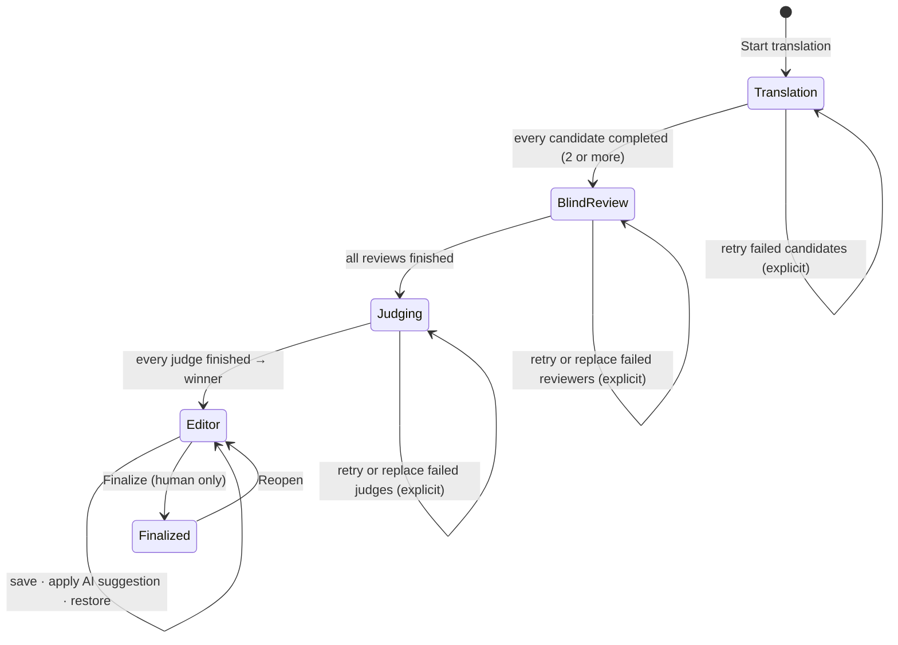
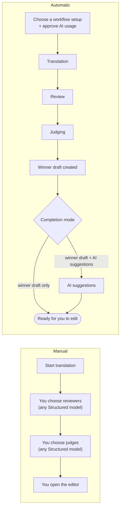

# Translation workflow

## Stages

| UI name | Code | What a run produces |
| --- | --- | --- |
| Translation | `Experiment` | The source, instructions, and the exact guidance versions used |
| Translation candidate | `TranslationRun` | One model's full translation |
| Blind review | `ReviewRound` → `ReviewRun` → `ReviewEvaluation` | Scores (1–10) for faithfulness, naturalness, terminology, instruction adherence, and an overall score, with strengths, issues, and corrections for each anonymous candidate. The page summarizes the overall scores per candidate model (`Results::ScoreSummary`) |
| Judging | `JudgeRound` → `JudgeRun` → `JudgeEvaluation` | A rank and score (1–100) per candidate, a winner, a rationale, and a confidence; the page shows the average judge score per candidate model |
| Final translation | `FinalTranslation` → `FinalTranslationVersion` | Versioned human-edited text; version 1 is the winner |
| AI suggestions | `FinalizationRound` → `FinalizationRun` | A proposed translation for one exact base version, with a change summary and terminology notes |
| Automatic workflow | `PipelineRun` + `PipelineEvent` | Stage progress and an approved request plan |
| Workflow setup | `WorkflowProfile` → `WorkflowProfileRevision` | Models per role and a completion mode |

## Choosing models for each role

Translators, reviewers, judges, and suggestion models are all searched in the OpenRouter catalog (`shared/_model_browser`); browsing the catalog is free. A picked model is resolved on the server (`OpenRouter::ModelResolver`) and saved as an `LlmModel`; nothing about it is taken from the request except its identifier. Reviewers do not have to be models that translated.

Review, judging, and suggestions ask for a strict JSON schema with `provider.require_parameters`, so they need a model with an OpenRouter provider that lists `structured_outputs`. The catalog marks such models *Structured*, only they are offered for those roles, and the server refuses any other (`CatalogModelSelection`). A model without it can still translate. If a provider stops serving a model with structured output, the run fails with `structured_output_unavailable` instead of a bare 404.

### Replacing a failed reviewer or judge

A failed reviewer can be replaced with another model until judging starts, and a failed judge until the final translation exists (`BlindReviews::ReplaceFailed`, `Judging::ReplaceFailed`). Under the experiment and round locks, the service checks that the run is current and failed and that the new model has not been used in the round, creates the new run for the same anonymous candidates under the payer shown on the page, and marks the failed run `superseded_by` the new one. The failed run keeps its error and cost, and only the new model's work is billed. The round returns to running and then completes when every current run has succeeded; judging, suggestion prompts, and the average score panels read only current runs.

## Blindness

`BlindReviews::Prompt` and `Judging::Prompt` send candidates under labels (`Candidate A`, `B`, …) assigned per run. The application never adds the candidate's model name, provider, or identifier to these prompts. The prompts do include the source, your guidance, and the candidate texts, so identifying cues written inside that text could still reach a reviewer; anonymity is designed to reduce bias, not proven to remove it. The label-to-candidate mapping is stored in the evaluations and is shown only to the owner ("Written by (hidden from AI)").

## Choosing the winner

Each judge ranks every candidate. A candidate receives `N − rank + 1` ranking points (Borda count) from each judge. Candidates are ordered by total points, then by mean overall score, then by the stable `TranslationRun` ID. A round declares a winner only when **every** current judge succeeded; a failed judge leaves the round without a winner until it is retried or replaced. The average scores shown on the review and judging pages summarize the scores for people; they do not pick the winner, so the winner can differ from the candidate with the highest average. For segmented documents, each judge's ranking is the source-length-weighted sum of its per-part rankings.

## Manual and automatic modes

Manual mode needs at least two completed candidates to continue to blind review and judging. Automatic mode never applies a suggestion, never changes draft text, and never finalizes. The owner can stop automation at any time. Stopping prevents future stages but cannot cancel a request already sent, deletes nothing, and still allows manual continuation.

### Approved request plan

Before an automatic launch the workspace shows, and the owner approves, a plan of `models × parts` initial requests per role and the maximum including built-in retries. The plan is stored on the `PipelineRun`. For multi-part documents its SHA-256 digest is compared at submit, and the launch is refused if the plan changed since the preview. Any retry after a terminal failure is a separate, explicit owner action with its own cost warning.

### Recovery

`PipelineReconciliationJob` scans a bounded batch every 10 minutes to repair missed advancement after crashes or queue failures. It uses a least-recently-reconciled cursor and row locks so permanently blocked workflows cannot starve newer ones. It processes only running or blocked automatic workflows. Operators can run the same bounded service with `bin/rails pipelines:reconcile`; the output contains aggregate counts only.

## Long documents

A document holds up to 100,000 characters. Only a source longer than the 4,000-character single-request target (`LongDocuments::Segmenter::TARGET_CHARACTERS`) is planned into parts; for it, Three Heavens derives an immutable, versioned list of lossless parts (`DocumentExecutionPlan` → `ExperimentSegment`), splitting at paragraph, line, sentence-like punctuation, and finally Unicode-safe hard boundaries. Rejoining the parts reproduces the source exactly.

- Each stage runs one request per model and part (`TranslationSegmentRun`, `ReviewSegmentRun`, `JudgeSegmentRun`, `FinalizationSegmentRun`). Only failed parts are retried.
- All of a stage's part requests are enqueued together after the launch commits, and Solid Queue runs up to `JOB_THREADS` of them at once (32 by default). Three models × 8 parts start together, so a stage takes about as long as its slowest part. The page counts finished parts per model ("5 / 8 parts done"); a model that reasons before answering can show 0 / 8 and then jump to 8 / 8, because its parts were running side by side. Each running job holds a database connection, so the connection pools are sized from `JOB_THREADS` (see [reliability](reliability.md)).
- The parent runs remain the logical candidate/reviewer/judge records used by history, benchmarks, winner selection, and workflow advancement.
- Parent cost is the sum of known child costs. If any child cost is missing, the total is marked partial instead of treating the unknown as zero.
- Review scores are source-length-weighted means.
- A manual edit invalidates the part alignment for further segmented AI suggestions; manual editing, restoring, finalizing, and export remain available.

### Context budget

Administrators configure each model's context window and maximum output under Admin → Models. Every scheduled request stores the capability snapshot and a conservative estimate (`serialized-utf8-bytes-v3`): about one estimated token per UTF-8 byte of the fully serialized request, plus framing, the response schema, an output reserve, and a 1,024-token safety margin. The output reserve is as large as possible up to 16,384 tokens (bounded by the model's maximum output and the context left after the input) and never below 4,096; reasoning models spend part of it thinking, and an answer cut off at the limit is still billed. Plain translation requests also limit reasoning (`Ai::OpenRouterClient::REASONING_BY_PREFIX`: a 1,024-token budget for Qwen, `minimal` for Gemini, `low` effort otherwise). A cut-off answer is never stored; its billed usage is recorded with `incomplete_response`. It is deliberately conservative and does not claim to match any provider's tokenizer. Models without configured capabilities fall back to 16,384/4,096 tokens and only for sources of at most 8,000 characters. A plan that does not fit fails **before** any request is sent.

Every request sends an explicit completion limit. Responses are streamed through a 1 MiB ceiling before JSON parsing; translations or suggestions per part are limited to 20,000 characters and assembled documents to 100,000. Nothing is silently truncated.

OpenRouter account settings must not force the context-compression plugin in a way that prevents per-request overrides, because Three Heavens disables it for fidelity-critical work.
