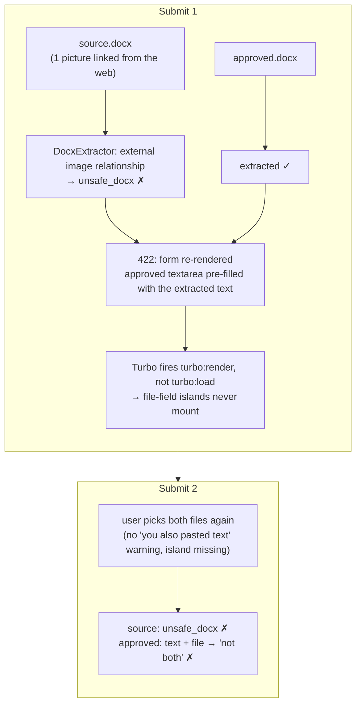

# Case 16 — A picture linked from the web rejected a whole DOCX, and the error page lost its file fields

[← All case studies](README.md) · Topics: document import, security policy, Turbo lifecycle, UX state · Evidence: [PR #106](https://github.com/XKeviNguyen/three_heavens/pull/106)

## Incident snapshot

| | |
| --- | --- |
| **Problem** | Creating a translation reference from two DOCX files (a Vietnamese sermon and its approved Japanese translation) reloaded the form with *"The DOCX cannot be processed safely. Provide either pasted text or an uploaded file for the approved translation side, not both."* The file pickers on that error page had fallen back to the browser's bare *Choose File / No file chosen* input. |
| **Impact / risk** | A user could not import an ordinary Word document, the message did not say which file failed or why, and the retry produced a second, confusing error. No data was lost and nothing was stored. |
| **Classification** | User-reported defect on the live site (2026-10-20). Two independent root causes: a DOCX import policy that was stricter than its threat model, and a React-island lifecycle gap after rejected Turbo form submissions. |
| **Fixed in** | [PR #106](https://github.com/XKeviNguyen/three_heavens/pull/106) (commits `df7719c`, `cff20b4` on `develop` at `75ffc90`), open at the time of writing. *Before* = `main` at [`0af83e1`](https://github.com/XKeviNguyen/three_heavens/tree/0af83e17e70d37a6794afab4f68276d72b527a99), the version the user reported against. |
| **Verification** | Both regression tests fail on `0af83e1` and pass after the fix. All 8 of the user's DOCX files extract after the fix (7 before). Local `bin/ci` and GitHub CI passed on the PR head `cff20b4`. The user confirmed both fixes by hand in a local run. |



*Two defects compounded: the first rejection was wrong, and the page that reported it had lost the warning that would have prevented the second.*

## What went wrong

The user uploaded a source DOCX and an approved-translation DOCX on `/translation_references/new`. The first submission failed on the source file only; the translation side extracted successfully. As designed, the server re-rendered the form with the extracted translation in its textarea, so the user would not have to upload it again. Browsers always clear file inputs on a re-rendered page.

The user did not see that pre-filled text as a conflict and chose both files again. Now the translation side had pasted text *and* a file, which the server refuses. The combined message joined both errors into one sentence, which read like a single nonsensical complaint.

Normally the file picker warns about exactly this (*"You also pasted text above."*), but on the error page the picker was not the React component at all, only the server-rendered fallback input.

## Root cause 1 — an external picture was treated like an external template

`DocxExtractor#parse_relationships` accepted an external relationship only if it was a hyperlink
([`app/services/source_imports/docx_extractor.rb#L267-L273` at `0af83e1`](https://github.com/XKeviNguyen/three_heavens/blob/0af83e17e70d37a6794afab4f68276d72b527a99/app/services/source_imports/docx_extractor.rb#L267-L273)):

```ruby
seen_ids << id
external = target_mode == "External"
if external
  raise unsafe_archive_error unless type.end_with?("/hyperlink")   # ← every other external target refused
else
```

The failing DOCX contained one picture that was *linked*, not embedded. That is what Word or LibreOffice produces when an image is pasted from a web page:

```xml
<Relationship Id="rId5"
  Type="http://schemas.openxmlformats.org/officeDocument/2006/relationships/image"
  Target="https://upload.wikimedia.org/…/800px-Ishtar_Gate_at_Berlin_Museum.jpg"
  TargetMode="External"/>
```

with the body referring to it by `<a:blip r:link="rId5"/>` rather than `r:embed`. The other five pictures in the same file were embedded and were never a problem.

**The violated assumption:** that any external target is dangerous to *this* code path. External relationships matter when something dereferences them. A remote `attachedTemplate` makes Word fetch a template (a known document-delivery attack), and a server that renders documents could be turned into an SSRF probe. But the extractor reads text only and never follows any relationship. The app never renders or converts the DOCX. The original bytes are stored unchanged and served only to their owner as a download ([`documents_controller.rb#L8-L16`](https://github.com/XKeviNguyen/three_heavens/blob/0af83e17e70d37a6794afab4f68276d72b527a99/app/controllers/documents_controller.rb#L8-L16)), and opening that download is the same as opening the user's own file. The rule had been pinned by a test that asserted an external image was `unsafe_docx` ([`extraction_test.rb#L513-L528`](https://github.com/XKeviNguyen/three_heavens/blob/0af83e17e70d37a6794afab4f68276d72b527a99/test/services/source_imports/extraction_test.rb#L513-L528)), so the policy was deliberate but broader than its threat model. It dates from the document-fidelity work in [PR #46](https://github.com/XKeviNguyen/three_heavens/pull/46) (commit `89b5efb`).

## Root cause 2 — islands mounted on `turbo:load`, which a rejected form never fires

The island adapter mounted components on `turbo:load` and `turbo:frame-load` only
([`app/frontend/islands/mount.tsx#L118-L122` at `0af83e1`](https://github.com/XKeviNguyen/three_heavens/blob/0af83e17e70d37a6794afab4f68276d72b527a99/app/frontend/islands/mount.tsx#L118-L122)):

```ts
export function startIslands(): void {
  if (!state.listening) {
    state.listening = true
    document.addEventListener("turbo:load", mountAll)
    document.addEventListener("turbo:frame-load", mountAll)
```

When a Turbo form submission receives a 4xx response, Turbo (turbo-rails 2.0.23) calls `formSubmissionFailedWithResponse`, which renders the response with `view.renderPage(…)`. That dispatches `turbo:render`. No visit completes, so **no `turbo:load` follows**. `turbo:before-render` had already unmounted the old islands, and nothing mounted the new ones. Every form with a file field showed the raw fallback input after any server-side validation error. The adapter dates from [PR #90](https://github.com/XKeviNguyen/three_heavens/pull/90); the file-field island from [PR #91](https://github.com/XKeviNguyen/three_heavens/pull/91).

The existing system tests always waited for islands after a normal `visit` (a `turbo:load`) and never after a rejected submission, so the gap was invisible.

## How to find it — the diagnostic path

1. **Separate the two messages.** The flash joins one error per side. Run the real files through the extractor directly (`bin/rails runner` → `SourceImports::TextExtractor.call(format: "docx", bytes:)`): the Vietnamese file failed with `unsafe_docx`, the Japanese file extracted 4548 characters. So the "not both" error could only come from a textarea that already held text, which the first re-render had put there.
2. **Find which check fires.** `unsafe_docx` has about twenty call sites. Listing the package (`zipfile`: compression ratios ≈ 7.6, flags normal) ruled out the archive checks. Dumping the `.rels` parts showed one `TargetMode="External"` relationship whose type was `image`, and the hyperlink-only branch rejects exactly that.
3. **Ask what the rule protects.** `grep` for anything that converts or renders DOCX (`soffice`, `libreoffice`, `pandoc`) and for every reader of the stored blob: there was none besides the owner-only download. The rule guarded a fetch that never happens.
4. **For the UI, read the framework's code path, not its docs.** The installed `turbo.js` shows `formSubmissionFailedWithResponse → renderPage → turbo:render`, and no `turbo:load` on that path.
5. **Reproduce both before fixing.** Each regression test below was run on `0af83e1` first and failed for the reported reason.

## How the fix works

**DOCX policy.** External relationships are allowed by an explicit suffix allow-list: hyperlinks and images. Every other external part, such as a remote `attachedTemplate`, `oleObject` or `subDocument`, is still `unsafe_docx`:

```ruby
# External targets the user's file may keep: links and pictures linked
# from the web. Extraction reads text only and never follows them. Every
# other external part (e.g. a remote attachedTemplate) is refused.
EXTERNAL_RELATIONSHIP_SUFFIXES = %w[/hyperlink /image].freeze
…
raise unsafe_archive_error unless type.end_with?(*EXTERNAL_RELATIONSHIP_SUFFIXES)
```

The user's file is respected as it is. Nothing is stripped or rewritten, the stored original keeps its pictures (embedded and linked), and only the text is extracted.

**Island lifecycle.** The adapter also mounts on `turbo:render`:

```ts
document.addEventListener("turbo:load", mountAll)
// A rejected form submission (e.g. 422) renders the response page with
// turbo:render only; no turbo:load follows.
document.addEventListener("turbo:render", mountAll)
document.addEventListener("turbo:frame-load", mountAll)
```

`mountContainer` is already idempotent (`if (mounted.has(container)) return`), so a normal visit that fires both `turbo:render` and `turbo:load` still mounts each island exactly once. A cache-preview render mounts islands that `turbo:before-render` then unmounts when the real page replaces the body, which is the existing cleanup path.

Alternatives not taken: stripping linked images, or rewriting the DOCX to remove them, would change the user's document. Converting the 422 response into a full page load would lose Turbo's form handling and scroll restoration for every form.

## Before vs after

| | Before | After |
| --- | --- | --- |
| DOCX with a picture linked from the web | `unsafe_docx`, the whole file refused | Text extracted; file stored unchanged |
| DOCX with a remote `attachedTemplate` | `unsafe_docx` | `unsafe_docx` (unchanged) |
| The user's 8 real DOCX files | 7 extract, 1 refused | 8 extract |
| File fields after a 422 re-render | Raw browser input, no warnings | React file field, *"You also pasted text above"* warning works |

## Reproduction and regression tests

- [`test/services/source_imports/extraction_test.rb`](../../test/services/source_imports/extraction_test.rb), *does not fetch external relationships or write traversal entries*: a minimal DOCX whose body holds a `<a:blip r:link="rIdImage"/>` drawing between two paragraphs, with an external `image` relationship to `https://example.invalid/picture.jpg`. It asserts the exact text `"Before picture\n\nAfter picture"`. On `0af83e1`: `SourceImports::Error: The DOCX package cannot be processed safely.`
- Same file, *rejects duplicate package declarations unsafe external parts and embedded objects*: the external-image case was replaced by an external `attachedTemplate`, which must still raise `unsafe_docx`, so the security boundary stays pinned.
- [`test/system/translation_reference_upload_test.rb`](../../test/system/translation_reference_upload_test.rb), *the file fields are enhanced again after the server rejects the form*: paste source text *and* attach a source file, submit, and expect the "not both" error plus two mounted `file-field` islands. On `0af83e1`: `expected to find css "[data-react-island='file-field'][data-react-mounted='true']" 2 times but there were no matches`.

Recorded results, on a disposable `postgres:17` with a `.env`-free worktree:
- Upload, product-tour and AI-settings system tests: 24 runs, 0 failures. Full `bin/rails test:system`: 216 runs, 2476 assertions, 0 failures. `tsc --noEmit` clean.
- `test/services/source_imports` + translation-reference, document-IO and source-upload integration tests: 124 runs, 1093 assertions, 0 failures.
- Full `bin/ci` with both fixes on `0af83e1` (style, TypeScript, island build, gem/npm/importmap audits, Brakeman, migrations, tests): passed. Rails tests 1296 runs, 13902 assertions; system tests 216 runs, 2476 assertions; 0 failures.
- After rebasing onto `develop` `75ffc90`, full `bin/ci` on the PR head `cff20b4`: passed. Rails tests 1316 runs, 14118 assertions; system tests 247 runs, 2772 assertions; 0 failures. GitHub Actions on the same head ([run 39373207797](https://github.com/XKeviNguyen/three_heavens/actions/runs/39373207797)): lint, scan_ruby, scan_js, test and system-test all passed.
- Manual check by the user with `bin/dev`: the two real DOCX files create a reference, and after a rejected submission the file fields stay enhanced.
- An independent read-only review found no blocking defect: no code path follows a relationship target or renders uploaded DOCX, and an external `/image` relationship never reaches the internal-part lookups.

## Trade-offs and remaining limitations

- The allow-list matches the relationship-type **suffix**, like the original hyperlink rule did. That is safe only because the extractor never dereferences targets. If the app ever renders, previews or converts uploaded DOCX server-side, external images become an SSRF and tracking surface and must be re-evaluated.
- A downloaded original that contains a linked picture will fetch it when the owner opens it in Word. That is the behaviour of their own file.
- The re-render still pre-fills the extracted text while the browser clears the file input. With the warning restored this is visible, but the joined error sentence still does not name the file. A per-side, per-file message is a follow-up.

## Lessons learned

- **A security rule needs its threat model written next to it.** "External relationships are unsafe" was true for code that follows them, not for a text extractor. Name the attack (remote template, SSRF), and allow-list what cannot trigger it.
- **"Page rendered" is not "page loaded."** With Turbo, any component bootstrapped on `turbo:load` silently disappears after a rejected form submission. Mount on `turbo:render` too, and keep mounting idempotent.
- **Test the error path's UI, not only the error.** The existing tests checked that the server refused bad input, but none checked what the page looked like afterwards.
- **Real user files beat synthetic fixtures.** The minimal DOCX fixtures never contained a picture pasted from the web. Running the extractor over a folder of real documents found the gap in seconds.

## Interview explanation

> A user couldn't create a translation reference from two Word files. The page came back with a combined error and plain browser file inputs. There were two bugs. First, our DOCX extractor refused any external relationship except hyperlinks, and the sermon had one picture pasted from Wikipedia, stored as a link rather than embedded. That rule guarded against remote templates and server-side fetches, but our extractor only reads text and never follows links, so it rejected a legitimate document for no security benefit. We now allow external hyperlinks and images by explicit list and still refuse remote templates. Second, our React islands mounted on `turbo:load`, but when Turbo renders a 422 form response it fires only `turbo:render`, so the file pickers fell back to raw inputs. That hid the "you also pasted text" warning and caused the user's second error. We mount on `turbo:render` too, which is safe because mounting is idempotent. Both fixes have regression tests that fail on the old code. The lessons: write a security rule's threat model next to it, and test what the error page looks like, not just that it errors.

## Sources

- PR: [PR #106](https://github.com/XKeviNguyen/three_heavens/pull/106)
- Before: `main` at [`0af83e1`](https://github.com/XKeviNguyen/three_heavens/tree/0af83e17e70d37a6794afab4f68276d72b527a99)
- External-relationship rule introduced in `89b5efb` ([PR #46](https://github.com/XKeviNguyen/three_heavens/pull/46))
- Island adapter introduced in `c7f4c84` ([PR #90](https://github.com/XKeviNguyen/three_heavens/pull/90)); file-field island in `3f491d1` ([PR #91](https://github.com/XKeviNguyen/three_heavens/pull/91))
- Turbo behaviour: turbo-rails 2.0.23 `turbo.js`, `Session#formSubmissionFailedWithResponse` → `View#renderPage` → `turbo:render`
