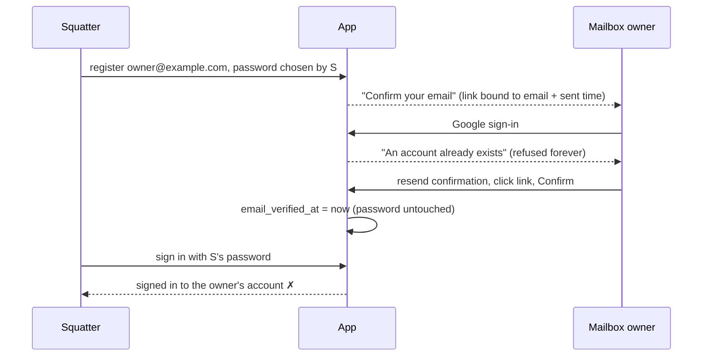

# Case 17 — An unconfirmed registration held the address forever

[← All case studies](README.md) · Topics: security, implicit state machines, data consistency, UX state · Evidence: [PR #119](https://github.com/XKeviNguyen/three_heavens/pull/119)

## Incident snapshot

| | |
| --- | --- |
| **Problem** | An email-and-password registration that was never confirmed had no way out. It held the address indefinitely, Google sign-in refused the address as "taken", and confirming the address kept whatever password the registrant had chosen. |
| **Impact / risk** | A pre-account takeover. Anyone could register another person's address with their own password, which blocked that person's Google sign-up. If the mailbox owner later confirmed the registration (for example after asking for a resend), the squatter's password signed in to the owner's account. |
| **Classification** | Design hardening, found by an audit of implicit state machines. It was not reported by a user, and there is no evidence that it was exploited. |
| **Fixed in** | [PR #119](https://github.com/XKeviNguyen/three_heavens/pull/119): commit `d6eb0a3`, hardened in `11b86eb` after independent review. *Before* = `develop` at [`8e8a378`](https://github.com/XKeviNguyen/three_heavens/tree/8e8a378e8daafb9dc634f385c30f227d41ce8d7b). |
| **Verification** | The four regression tests that target the takeover fail on `8e8a378` and pass after the fix. Two more tests, for mail spacing and the confirmation rate limit, fail on `d6eb0a3` and pass after `11b86eb`. Full local `bin/ci` passed. Codex and an independent read-only reviewer reviewed the final code; the reviewer found no remaining takeover path. |

*Before the fix, the step that proved who owns the mailbox never asked whether that person had chosen the password.*

## What went wrong

The account lifecycle had three states that were never named:

- **unconfirmed:** a password is set, `email_verified_at IS NULL`, and the account cannot sign in;
- **confirmed:** either a password account with a verified email, or a Google account created verified;
- **disabled.**

The only transition out of *unconfirmed* was confirmation. Nothing else could leave that state: there was no expiry, no replacement, and no Google path. Each piece of code on its own looked correct:

- **Registration** created the account with the submitted password and sent a link ([`registrations_controller.rb#L22-L26`](https://github.com/XKeviNguyen/three_heavens/blob/8e8a378e8daafb9dc634f385c30f227d41ce8d7b/app/controllers/registrations_controller.rb#L22-L26)). A second registration for the same address was refused as a duplicate.
- **Confirmation** set `email_verified_at` and nothing else ([`email_confirmations_controller.rb#L14-L15`](https://github.com/XKeviNguyen/three_heavens/blob/8e8a378e8daafb9dc634f385c30f227d41ce8d7b/app/controllers/email_confirmations_controller.rb#L14-L15)).
- **Google sign-in** refused any address that already belonged to an account, without asking whether that account had ever been confirmed ([`sign_in.rb#L28`](https://github.com/XKeviNguyen/three_heavens/blob/8e8a378e8daafb9dc634f385c30f227d41ce8d7b/app/services/google_identity/sign_in.rb#L28)).

## Root cause

**The violated invariant:** *a confirmed account's password was chosen by the person who controls the mailbox.*

Confirmation proved control of the mailbox. The password was chosen earlier, by whoever registered first, and nothing ever tied the two together. Because the state was implicit (a NULL timestamp, not a named status with defined transitions), nobody had asked what should happen to an unconfirmed registration when someone else turns up with the same address.

## How the fix works

The *unconfirmed* state gets explicit transitions, and each one keeps the invariant:

| Transition | Who can trigger it | Guard |
| --- | --- | --- |
| unconfirmed → confirmed | Whoever holds the link **and** the password | `EmailConfirmationsController#create` checks the password under the user's row lock and re-checks the token there, so a concurrent resend or replacement invalidates it. Confirming signs the user in. |
| unconfirmed → unconfirmed (replaced) | A new registration for the same address | `Accounts::Registration` replaces the password and `confirmation_sent_at`, which invalidates the earlier link. It is spaced at least `User::CONFIRMATION_EMAIL_INTERVAL` (3 minutes) after the last email, like a resend. |
| unconfirmed → confirmed via Google | Google, when it is authoritative for the address | `GoogleIdentity::SignIn` takes the account over under a lock, drops the password chosen before the mailbox was proven, and links the Google identity. |
| confirmed or disabled | (unchanged) | These keep the address. Disabled accounts are never replaced or adopted. |

After the fix, the squatter needs either the mailbox or the Google account, and those are exactly the things the address is meant to prove.

The same audit found six more implicit state machines, all fixed in the same PR:

| Where | Implicit state | Fix |
| --- | --- | --- |
| Launch | The glossary's active/current status, checked only before the lock | Lock and recheck it, as was already done for methodology profiles and references |
| Final translation | Finalized vs a running refinement round | Refuse to finalize under the same lock that refinement takes |
| AI runs | Status vs `completed_at`, held only by services | CHECK constraints on all 8 run tables, checked against existing rows before they are added |
| Product tour | "Signed out" inferred from "no tour island" | Public pages state `data-signed-in` |
| AI settings | Two confirmation flags that could both be on | One `confirming` value |
| Autosave | A save waiting behind a refused save | Send it once the refusal arrives |

## Before vs after

| | Before | After |
| --- | --- | --- |
| Someone registers your address first | You are locked out of Google sign-up, and confirming keeps their password | Registering again or using Google replaces their registration; confirming needs the password |
| Confirming an email | A button | The registration's password, then you are signed in |
| Registering again with an unconfirmed address | "Already taken" | Replaces the registration (at most once every 3 minutes) |
| Registering again with a confirmed or disabled address | "Already taken" | "Already taken" (unchanged) |

## Reproduction and regression tests

- [`test/integration/public_accounts_test.rb`](../../test/integration/public_accounts_test.rb):
  - *an unconfirmed registration does not keep the address from the person who controls the mailbox*: the whole squatter scenario, end to end.
  - *confirming requires the password chosen at registration*: covers missing, empty, wrong and array-shaped passwords.
  - *registering an unconfirmed address again is spaced like a resend*.
  - *confirmation attempts are rate limited with their own message*.
- [`test/integration/google_sign_in_test.rb`](../../test/integration/google_sign_in_test.rb):
  - an authoritative Google sign-in takes over an unconfirmed registration;
  - it never takes over a non-authoritative or disabled one;
  - someone who registers and then uses Google before confirming keeps Google sign-in only.

## Trade-offs and remaining limitations

- **Losing password sign-in.** Someone who registers and then signs in with Google before confirming loses password sign-in. The app has no flow to set a new password, and the earlier password cannot be told apart from a squatter's.
- **Griefing.** A squatter can still undo a legitimate registration, at most once every 3 minutes per address and 5 times an hour per network. The owner can always register again, or use Google.
- **The 3-minute spacing.** Re-registering within 3 minutes of the last email is validated but changes nothing, and it shows the same "check your email" response as every other registration.

## Lessons learned

- **Name every state and give each one an exit.** A NULL timestamp is a state. If nothing ever moves a record out of it, ask who else could arrive at that record and what they should be allowed to do.
- **Bind proof to the thing it authorizes.** Proving the mailbox authorized nothing about the password, because the password came from someone else, earlier. The step that proves identity must also check the credential that identity will use.
- **An audit by state machine finds bugs that a review by file misses.** Each controller was correct on its own. The gap only showed when the whole lifecycle was drawn: entry, exits, and who can trigger each one.
- **Independent review earns its cost on a security fix.** The first version of the fix opened a new mail-flooding path: re-registration skipped the resend spacing. The reviewer found it before merge.

## Interview explanation

> We audited the app for implicit state machines: lifecycles encoded as nullable columns rather than named states. The worst was an unconfirmed registration. It held its email address forever, Google sign-in refused that address as taken, and confirming it kept the password that whoever registered first had chosen. So a squatter could register your address, and if you later confirmed it, their password worked on your account. The root cause was that confirmation proved the mailbox but never bound that proof to the password. We gave the unconfirmed state explicit transitions: confirming needs the password, re-registering replaces an unconfirmed registration (spaced like a resend), and Google, when it is authoritative for the address, takes it over and drops the old password. Regression tests reproduce the whole attack and fail on the old code. An independent reviewer then caught that our first version let re-registration bypass the email throttle, which we fixed before merge. The lesson: give every state an exit, and make the step that proves identity also bind the credential.

## Sources

- PR: [PR #119](https://github.com/XKeviNguyen/three_heavens/pull/119)
- Before: `develop` at [`8e8a378`](https://github.com/XKeviNguyen/three_heavens/tree/8e8a378e8daafb9dc634f385c30f227d41ce8d7b)
- Fix: [`d6eb0a3`](https://github.com/XKeviNguyen/three_heavens/commit/d6eb0a32dca4d4db3c477ff38b620f8bfc6cbd90); review hardening: [`11b86eb`](https://github.com/XKeviNguyen/three_heavens/commit/11b86eb2b1ef6fe62e8817497607fac94b26015c)
- Confirmation token binding: [`user.rb#L10-L12`](https://github.com/XKeviNguyen/three_heavens/blob/8e8a378e8daafb9dc634f385c30f227d41ce8d7b/app/models/user.rb#L10-L12)
- The gem security update that unblocked CI: [PR #120](https://github.com/XKeviNguyen/three_heavens/pull/120)
